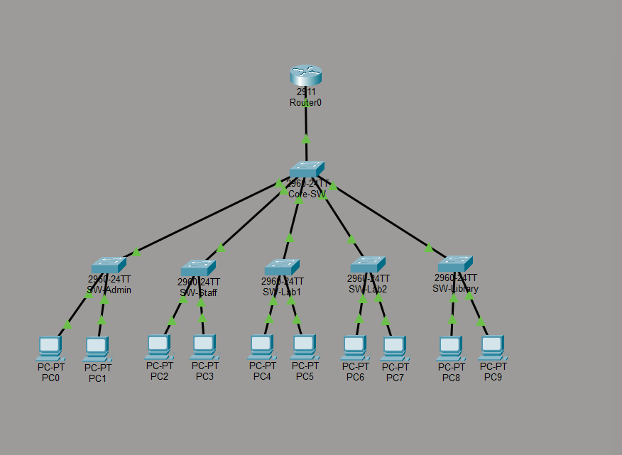

# Faculty of Engineering Network

A Cisco Packet Tracer coursework network by Omar Gouda, prepared during his Erasmus studies at Constantin Brâncuși University of Târgu Jiu. The repository preserves the original `.pkt` topology and screenshots extracted from the supplied academic report.

## Visible topology

The supplied topology image shows one Cisco 2911 router, a 2960 core switch, five departmental 2960 switches and ten PCs. Departments are Administration, Academic Staff, two student laboratories and the Library.

## Addressing described in the report

| VLAN | Department | IPv4 subnet |
|---|---|---|
| 10 | Administration | 192.168.10.0/24 |
| 20 | Academic Staff | 192.168.20.0/24 |
| 30 | Student Lab 1 | 192.168.30.0/24 |
| 40 | Student Lab 2 | 192.168.40.0/24 |
| 50 | Library | 192.168.50.0/24 |
| 60 | Servers, proposed in the report | 192.168.60.0/24 |

The report discusses DHCP, DNS and web services, but the supplied topology screenshot does not show a server. Those services, VLAN 60 and access-control rules are **not independently verified** here.

## Open and inspect

1. Use a compatible Cisco Packet Tracer installation.
2. Open `topology/Faculty_Engineering_Network.pkt`.
3. Allow interfaces to settle and inspect device configurations.
4. Follow [the validation checklist](docs/validation.md), recording actual results rather than assuming the report's design claims are implemented.

No Packet Tracer execution was available during repository cleanup. The project has not been imported into another simulator or recreated from assumptions.

## Evidence from the original report

| Screenshot | Observed result |
|---|---|
| [Administration to 192.168.20.10](docs/evidence/image3.png) | 1 reply of 2 packets, 50% loss |
| [Ping to 192.168.30.10](docs/evidence/image4.png) | 3 replies of 4 packets, 25% loss |
| [Library PC8 to 192.168.10.10](docs/evidence/image5.png) | 4 replies of 4 packets, 0% loss |

The screenshots demonstrate some cross-subnet replies, not a comprehensive successful test suite. Initial address resolution is one possible explanation for a first lost ping, but it was not confirmed; repeat the tests and investigate any persistent loss.

## Files

- `topology/Faculty_Engineering_Network.pkt`: unchanged simulation file.
- `docs/evidence/`: original topology and ping screenshots.
- `docs/validation.md`: repeatable configuration and connectivity review.

## Scope

Educational network simulation only. VLAN segmentation alone does not enforce a security policy. Internet access, DNS, DHCP, web hosting, ACLs, resilience and capacity need separate verification before being claimed as completed features.
